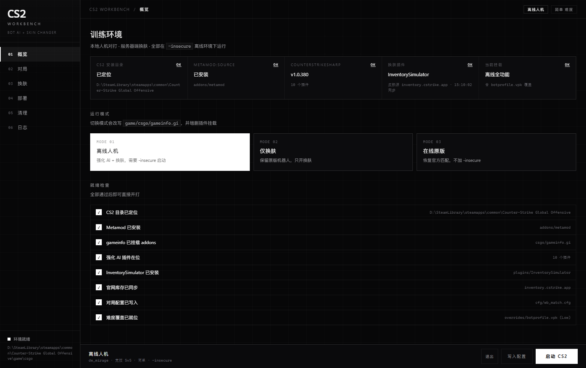
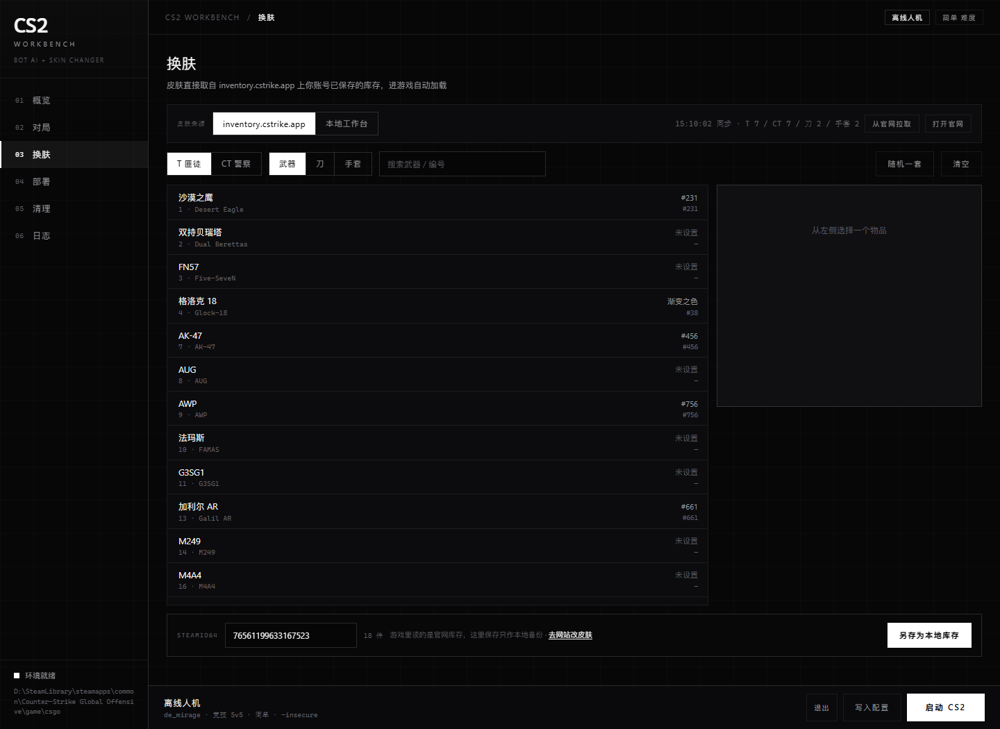
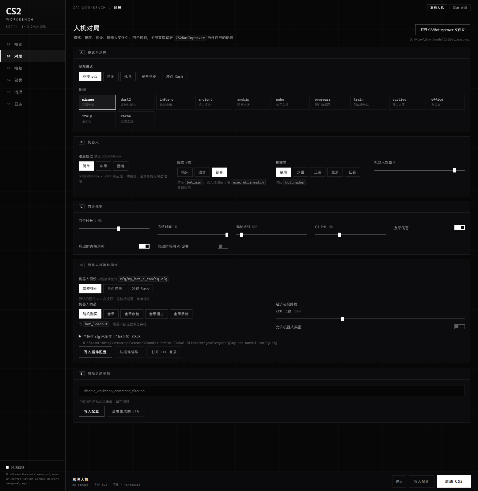
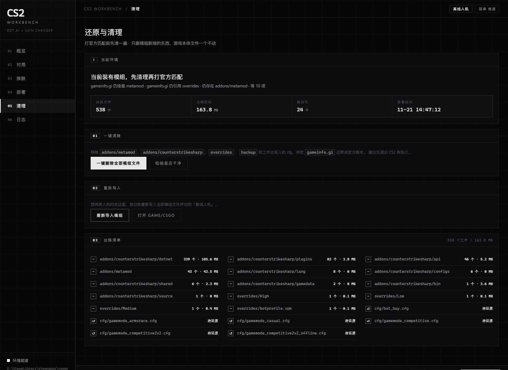

# CS2 WORKBENCH

把「强化的离线人机」和「服务器端换肤」捏成一个本地工作台，全部在 `-insecure` 离线环境下运行。

- 人机 AI：[ed0ard/CS2-Bot-Improver](https://github.com/ed0ard/CS2-Bot-Improver)（Metamod + CounterStrikeSharp 插件组 + botprofile 覆盖）
- 换肤：[ianlucas/cs2-inventory-simulator](https://github.com/ianlucas/cs2-inventory-simulator)（服务器端 InventorySimulator 插件，皮肤取自 [inventory.cstrike.app](https://inventory.cstrike.app)）
- 界面：原生 HTML/CSS/JS，纯黑白单色；后端是 Python 标准库，打包成单文件 exe

## 界面

| 概览 | 换肤 |
| --- | --- |
|  |  |

| 对局 | 清理 |
| --- | --- |
|  |  |

---

## 一、启动

双击 **`CS2Workbench.exe`**，浏览器自动打开 `http://127.0.0.1:8787/`。

- 单文件，不需要装 Python；里面已经带了 Metamod / CounterStrikeSharp / 两套插件
- **模组来源优先用你自己那份** `D:\Klay\Downloads\CS2BotImprover`（你在 Panel.exe 里改的参数会直接生效）；找不到时才用 exe 内嵌的模组包，并解到 `mods/`（约 170 MB，只解一次）
- 运行时数据（`state.json`、`ledger.json`、`backup/`）也放在 exe 旁边；目录不可写时自动改用 `%LOCALAPPDATA%\CS2Workbench`
- 再双击一次不会开第二个进程，只会把已经打开的页面调出来
- 关掉页面不会停服务，点右下角 **退出** 或结束 `CS2Workbench.exe` 进程
- 双击启动的 exe 是**独立进程**（父进程是 explorer），关掉终端、关掉任何宿主程序都不影响服务；`start.bat` 用 `start` 拉起，同样不留依赖
- 万一服务真的被结束了，页面不会只甩一个 `Failed to fetch`：顶部会弹出白色提示条，页面变暗暂停，**每 2.5 秒自动重连**，服务一回来就自动接回原来的状态（也可以点提示条右侧「立即重试」，或重新双击 exe）
- 想从终端启动又不希望随终端关闭：`set WB_DETACH=1` 再运行，exe 会用 `DETACHED_PROCESS` + `CREATE_BREAKAWAY_FROM_JOB` 把自己重新拉成独立进程

> 首次使用先看「部署」页：确认 CS2 目录 → 点「安装 / 更新模组」。

### 常驻运行（关掉任何宿主程序都不停）

「部署」页第 04 块，一次设置解决「关掉 WorkBuddy / 终端后服务就没了」：

| 按钮 | 做了什么 |
| --- | --- |
| **设为常驻运行** | ① 在 `%APPDATA%\…\Start Menu\Programs\Startup\` 放一个 `CS2 Workbench.lnk`（登录 Windows 自动启动，`--no-browser` 静默）；② 立刻写 `launch.flags`，再用 `explorer.exe` 把 exe 拉起来 —— 新进程的父进程是 explorer，**脱离当前进程树**，随后接管端口（老进程自己退出） |
| **打开启动文件夹** | 直接看/删那个快捷方式，透明可控 |
| **取消常驻** | 删掉启动文件夹里的快捷方式，当前服务不受影响 |

不用 `schtasks` / 计划任务，不用管理员权限，也不会往系统里塞服务。判断是否真的独立了：

```powershell
Get-CimInstance Win32_Process -Filter "Name='CS2Workbench.exe'" |
  Select-Object ProcessId, ParentProcessId
# 第一层父进程应该是 explorer.exe
```

### 桌面快捷方式（不打开工作台也能开人机局）

「部署」页第 03 块的 **创建桌面快捷方式** 会在桌面放一个 `CS2 人机对局.lnk`，内容是：

```
steam.exe -applaunch 730 -insecure -console -novid +exec wb_match.cfg +game_type 0 +game_mode 1 +map de_mirage
```

双击就带着强化 AI 和换肤进图，完全不需要工作台在跑（`-insecure` 已包含）。换地图/模式后回到工作台点一次「写入配置」再重新创建即可。

源码方式调试：`python server.py`。重新打包：`python tools/build_exe.py`（需要 `pip install pyinstaller pillow`）。

---

## 二、六个页面

| 页面 | 作用 |
| --- | --- |
| **概览** | 环境状态灯、运行模式切换、就绪检查清单 |
| **对局** | 游戏模式、地图、机器人数量与强度、回合规则、模板预设与机器人物品（直接同步进 `CS2BotImprover` 的 cfg）、附加启动参数；右上角可一键打开 `CS2BotImprover` 文件夹 |
| **换肤** | 皮肤来源切换（官网 / 本地）、从官网拉取、逐把武器挑皮肤 |
| **部署** | 指定 CS2 路径、安装/更新模组、一键自检并修复、恢复在线模式、打开目录 |
| **清理** | 一键删除模组、校验是否干净、重新导入 |
| **日志** | 每次操作的记录，排查时先看这里 |

右上角的 `离线人机 / 中等` 是当前模式与难度；底部条永远可以「写入配置」「启动 CS2」。

---

## 三、三种模式在改什么

模式切换的核心是 `game/csgo/gameinfo.gi` 里的 `SearchPaths`：

| 模式 | gameinfo | `-insecure` | 人机 AI | 换肤 |
| --- | --- | --- | --- | --- |
| 离线人机 | 挂载 `csgo/overrides/botprofile.vpk` + `csgo/addons/metamod` | 需要 | 强化 | 可用 |
| 仅换肤 | 只挂载 `csgo/addons/metamod` | 需要 | 原版（机器人插件被移到 `plugins_off/`） | 可用 |
| 在线原版 | 官方原样 | 不要 | 无 | 无 |

「离线人机」还会把 `overrides/<难度>/botprofile.vpk` 复制成 `overrides/botprofile.vpk`，这就是低 / 中 / 高三个难度的真实来源。

**要打官方匹配，不要只用「恢复正常在线模式」——请到「清理」页点「一键删除全部模组文件」**，它会把整个 `addons/` 和 `overrides/` 移走，并把被模组覆盖过的 `cfg/gamemode_*.cfg`、`gameinfo.gi` 还原成官方内容。

---

## 四、对局配置怎么生效

### 4.1 直接写进插件的配置（不再只是工作台自己记）

「对局」页的模式、难度、预设、机器人物品、回合规则，会真正落到 **`D:\Klay\Downloads\CS2BotImprover`** 里的插件配置上，并且**同一个文件在模组目录和游戏目录两边保持一致**——你在 Panel.exe 里改的、在工作台改的，是同一份东西。

| 界面项 | 落到哪 |
| --- | --- |
| 机器人预设（常规强化 / 自由混战 / 冲锋 Rush） | `cfg/my_bot_normal_config.cfg`、`my_bot_ffa_config.cfg`、`my_bot_rush_config.cfg`，并由 `gamemode_<模式>_server.cfg` 里的 `exec` 决定加载哪个 |
| 难度（简单 / 中等 / 困难） | 复制 `overrides/<难度>/botprofile.vpk` → `overrides/botprofile.vpk` |
| 机器人物品 | 预设文件里的 `bot_loadout`（随机 / 全甲 / 全甲步枪 / 全甲狙击 / 全甲手枪） |
| 允许买雷、ECO 上限 | `bot_allow_grenades`、`bot_eco_limit` |
| 回合规则 | `mp_roundtime`、`mp_freezetime`、`mp_startmoney`、`mp_c4timer`、`mp_friendlyfire`、`bot_quota` |
| 瞄准 / 投掷物 | `bot_aim`、`bot_nades`（BotAimImprover / NadeSystem 读的就是这两个） |

写回是**逐行替换**：只动上表这些 cvar，其它行（`bot_randomizer`、`nav_*`、`alias` 那一大串、bind、你自己加的参数）原样保留，换行风格（CRLF）也保持一致。第一次改模组原文件前，会把它备份到 `CS2-Workbench/botcfg-backup/`。

### 4.2 工作台自己的 cfg

| 文件 | 时机 | 内容 |
| --- | --- | --- |
| `wb_match.cfg` | 启动时 `+exec wb_match.cfg` | 服务器名、回合规则、机器人、InventorySimulator 指向 |
| `gamemode_<模式>_server.cfg` | 每次加载地图后 | 先 `exec` 模组的预设，再压上工作台的设置 |
| `wb_inmatch.cfg` | 手动 `exec wb_inmatch` | `bot_aim` / `bot_nades`，进图后想改 AI 就执行它 |

### 4.3 自动自检（解决「关掉 exe 再打开就失效」）

换肤和强化人机真正依赖四样东西，任何一样被 CS2 校验 / 模组 Panel / 误操作改回去，进游戏就只剩原版 bot、没有皮肤。工作台现在在这四个时机会**自动检查并修复**：打开 exe、点「安装 / 更新模组」、点「启动 CS2」、手动点「一键自检并修复」。

| 检查项 | 修复动作 |
| --- | --- |
| `gameinfo.gi` 里没有 `csgo/addons/metamod` | 用模组自带模板重写（字节级还原） |
| `addons/metamod` 或 CounterStrikeSharp 核心缺失 | 从模组包重新部署 |
| `plugins/` 里少了机器人插件，或插件被挪进 `plugins_off/` | 挪回来 / 从包里补齐 |
| `overrides/botprofile.vpk` 与所选难度不一致或丢失 | 重新复制对应难度 |

所以**关掉 exe、重开 exe，不会再出现「皮肤没了、bot 变回原版」**——开机那一下就会把上面四项补齐，日志里会写「环境自检已修复：…」。

启动命令等价于：

```
steam.exe -applaunch 730 -insecure -console -novid +exec wb_match.cfg +game_type 0 +game_mode 1 +map de_mirage
```

所以**请用工作台的「启动 CS2」按钮**，不要直接在 Steam 里点开始游戏（那样不会带 `-insecure` 和 cfg）。

---

## 五、换肤：直接吃 inventory.cstrike.app 的数据

「换肤」页顶部有皮肤来源开关，默认是**官网**：

| 来源 | 游戏读哪里 | 怎么改皮肤 |
| --- | --- | --- |
| inventory.cstrike.app | `invsim_url "https://inventory.cstrike.app"`，插件按 SteamID 拉你网站上保存的库存 | 在网站上改完，游戏里 `!ws` 刷新 |
| 本地工作台 | `invsim_url "http://127.0.0.1:<端口>"`，工作台按官方格式回库存，完全离线 | 在工作台里挑，保存后 `!ws` |

- **从官网拉取**：读 `https://inventory.cstrike.app/api/equipped/v5/<steamid>.json`，把网站上的武器 / 刀 / 手套 / 磨损 / 图案 / StatTrak / 改名全部映射到编辑界面，方便对照
- 网站数据是只读的（写回需要 Steam 登录态，工作台不做）；想改还是去网站改，或者点「另存为本地库存」把当前内容转成本地来源再编辑
- 拉取到的库存会缓存成 `siteCache`，概览页会显示「皮肤源 inventory.cstrike.app · HH:MM:SS 同步」

返回的数据就是插件定义的 `EquippedV5Response`：

```json
{
  "agents": {}, "collectible": null, "graffiti": null, "loadout": null,
  "musicKit": null, "pet": null,
  "knives": { "2": { "def": 515, "paint": 619, "wear": 0.0, "nametag": "M00N" } },
  "gloves": { "2": { "def": 5030, "paint": 10045, "wear": 0.06 } },
  "tWeapons":  { "7": { "def": 7, "paint": 456, "wear": 0.0, "seed": 531 } },
  "ctWeapons": { "7": { "def": 7, "paint": 282, "wear": 0.15 } }
}
```

- `2` = 匪徒（T），`3` = 警察（CT）
- `paint` 是 paintKit 编号，插件直接用，所以**编号才是生效值**，界面上显示的名字只是标注
- 用官网来源时需要联网；断网训练就切「本地工作台」

> **为什么本地来源不用 `inventories.json`？**
> 插件在加载瞬间就会读这个文件，而 CS2 客户端此时全局变量还没初始化，
> `Utilities.GetPlayers()` 会抛 `Global Variables not initialized yet`，
> 直接导致 InventorySimulator 加载失败。改走本地 HTTP 接口绕开了这个问题，
> 也顺带支持了 `!ws` 热刷新。

---

## 六、清理 / 重新导入（在线游玩前必看）

「清理」页干两件事：

**一键删除全部模组文件**

1. 删除 `addons/metamod`、`addons/counterstrikesharp`、`addons/BotController|BotHider|BotVision`、`overrides/`、`backup/`
2. 删除 `cfg/wb_match.cfg`、`cfg/wb_inmatch.cfg`、`cfg/gamemode_*_server.cfg`
3. 把被模组覆盖过的本体文件（`cfg/gamemode_*.cfg` 等）从台账备份还原
4. 把 `gameinfo.gi` 换回不含 `addons/metamod` 的官方版本
5. 顺手清理空目录，最后给出「还剩下什么」

**重新导入模组**：按台账重新写入全部文件，并切回「离线人机」，随时可以再练。

安全设计：

- 所有操作都在 `ledger.json` 里有记录，只删自己写进去的东西；`pak01_*.vpk`、`bin/`、`maps/` 这些本体文件不碰
- 删除前会二次确认；执行前建议先退出 CS2
- 「校验是否干净」会检查 `gameinfo.gi` 是否还挂着 metamod / overrides、`addons` / `overrides` / `wb_*.cfg` 是否还在
- 万一还有残留，Steam 右键 CS2 →「属性」→「已安装文件」→「验证文件完整性」即可彻底修复

> **VAC 说明**：这些模组必须配 `-insecure` 才能用，而 `-insecure` 会关闭 VAC 并禁止官方匹配。想在官匹正常游玩，请先执行「一键删除全部模组文件」，并确认 Steam 启动项里没有 `-insecure`。

---

## 七、常见问题

**皮肤不生效？**
1. 确认 `SteamID64` 和你当前登录的账号一致（工作台会自动读取 `loginusers.vdf` 里的 AutoLogin 账号）
2. 官网来源要先在网站上保存过库存；点「从官网拉取」能看到东西才说明账号对得上
3. 保存后在游戏内按 `!ws` 刷新；换图 / 重进服务器也会重新拉取
4. 本地来源时，工作台要一直开着——插件是向本机工作台要库存的
5. 当前模式必须是「离线人机 / 仅换肤」

**机器人没有变强？**
- 概览页「gameinfo 已挂载 addons」必须是 ✓；对局页的难度只影响 `botprofile.vpk`，AI 行为来自插件，装好即为强化版。

**CS2 起不来 / 进图报错？**
- 部署页确认 `CounterStrikeSharp 核心`、`Metamod`、`gamedata` 全部为 ✓
- 更新游戏后模组可能失效，重新点「安装 / 更新模组」
- 需要 .NET 运行时随 CSSharp 一起分发，无需额外安装

**点「一键删除」没反应？**
- 先关掉 CS2（文件被占用时删不掉）
- 看「日志」页的错误行，通常是权限问题（用管理员身份运行 exe）

**端口被占用？**
- 工作台会自动在 8787–8799 之间找空端口，取页面地址为准

---

## 八、目录结构

```
CS2-Workbench/
├─ CS2Workbench.exe       双击即用（自带 web / data / 模组包）
├─ start.bat              备用启动（有 exe 就调 exe，否则跑源码）
├─ server.py              本地服务端（标准库，无依赖）
├─ state.json             运行状态（模式、难度、对局参数、库存模型、官网缓存）
├─ ledger.json            部署台账（新建 / 改写的文件 + 备份位置）
├─ ledger/files/          被改写文件的原始副本，还原时用
├─ backup/                原始 gameinfo.gi、旧版 CSSharp 核心备份
├─ exports/               导出的 inventories.json（给专用服务器用）
├─ data/catalog.json      武器 / 刀 / 手套 目录
├─ tools/build_catalog.py 重新生成皮肤目录
├─ tools/build_exe.py     打 exe（含图标、模组包）
└─ web/                   index.html / theme.css / app.js
```

想给某个皮肤补中文名，改 `tools/build_catalog.py` 里的 `PAINT_NAMES`，再执行：

```
python tools/build_catalog.py
```

---

## 九、注意

- 这些模组只在**本地 / 私有服务器**上合法使用，`-insecure` 会关闭 VAC；带模组去连官方匹配既连不上也不安全。
- 模组文件版权归各自作者所有（Bot-Improver 为 AGPL-3.0，InventorySimulator 为 MIT），本工作台只做整合与配置管理。
